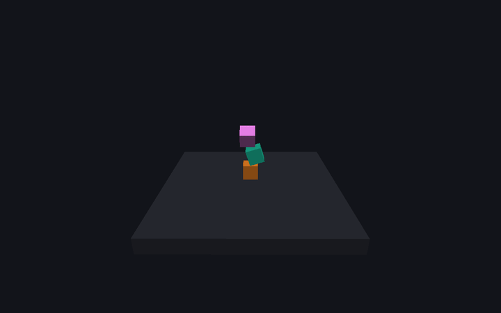
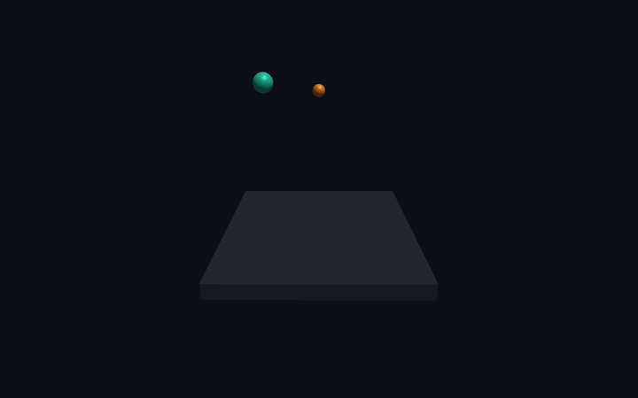
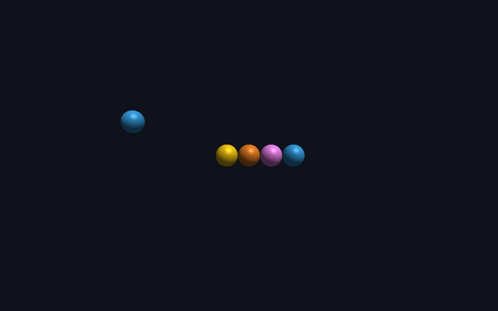
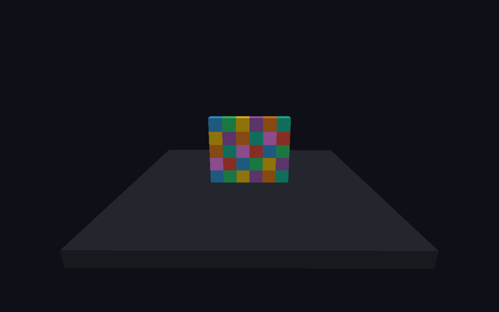
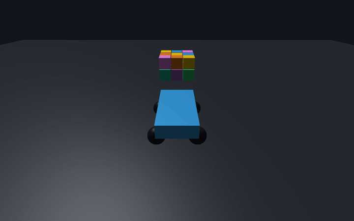
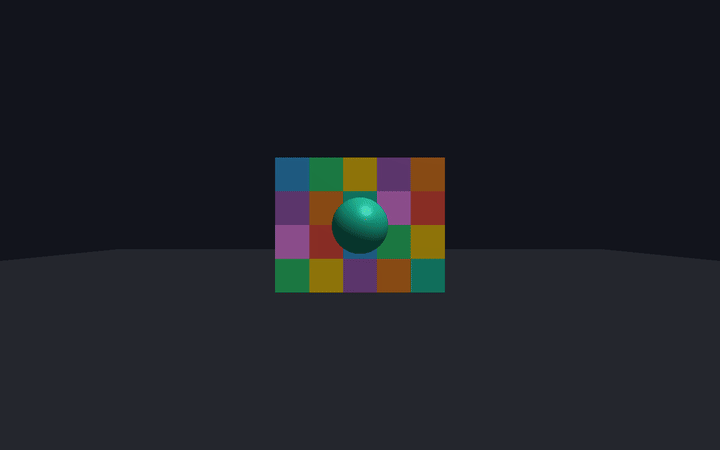
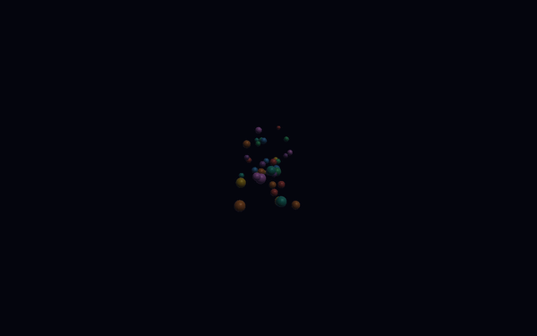

# Physics Demo — teaching modern C++ + game-physics architecture

[](https://github.com/jaroshevskii/physics-demo/actions/workflows/macos.yml)
[](https://github.com/jaroshevskii/physics-demo/actions/workflows/linux.yml)
[](https://github.com/jaroshevskii/physics-demo/actions/workflows/windows.yml)
[](https://github.com/jaroshevskii/physics-demo/actions/workflows/format.yml)
[](https://github.com/jaroshevskii/physics-demo/actions/workflows/release.yml)

A set of small 3D rigid-body demos built to teach **modern C++** and the
**architecture of a real collision/physics engine**. The code deliberately
separates a pure, deterministic, fully-tested physics core from app logic and
rendering, so each layer can be understood — and tested — on its own.

It reuses the architecture of the [`fifteen-puzzle`](../fifteen-puzzle) project —
a C++ port of Point-Free's **Composable Architecture (TCA) 2.0** + the
**Dependencies** library — and borrows the *ideas* of Apple's **RealityKit** ECS
(value-type components, systems as pure functions over a per-frame context,
simulation separated from rendering, collision **events**, `scene.raycast`,
force effects, an ordered system registry).

Stack: **SDL3** (window + input) · **Metal** + **OpenGL** (two swappable render
backends behind one interface) · **CMake** · C++26 named modules with `import
std;` · Homebrew LLVM.

Every demo runs on **either backend** — pick with `--backend metal|gl` (Metal is
the default on macOS). The rendering interface is designed Metal-first (draws are
recorded and flushed as a few *instanced* GPU draws); the OpenGL backend fills in
the same contract for portability. See [Rendering backends](#rendering-backends).

## The demos

Each demo below shows an animated GIF; the **still PNG** link next to it is a
crisp full-resolution frame.

| Demo | Preview |
| --- | --- |
| **Cubes** (`sandbox`) — oriented boxes fall, collide, topple, bounce.<br>[still PNG](docs/img/sandbox.png) |  |
| **Ball Pit** (`ballpit`) — hundreds of spheres of varied mass pile & bounce; stable resting stacks thanks to warm-starting.<br>[still PNG](docs/img/ballpit.png) |  |
| **Newton's Cradle** (`cradle`) — pendulum spheres on distance constraints; momentum transfers through the row. The definitive showcase of the solver upgrades.<br>[still PNG](docs/img/cradle.png) |  |
| **Explosions** (`explosion`) — a wall of boxes blown apart by a radial impulse (force field).<br>[still PNG](docs/img/explosion.png) |  |
| **Raycast Car** (`car`) — a chassis floating on four raycast wheels with spring-damper suspension; drive/steer.<br>[still PNG](docs/img/car.png) |  |
| **Fireworks** (`fireworks`) — thousands of CPU-**parallel** particles rendered as a point cloud.<br>[still PNG](docs/img/fireworks.png) |  |
| **Shooting Gallery** (`shooter`) — a first-person camera; fire fast, heavy sphere **bullets** that knock down a wall of boxes. Shows speculative contacts (fast bullets don't tunnel) + momentum transfer.<br>[still PNG](docs/img/shooter.png) |  |
| **Corridor** (`corridor`) — a closed tube that fills with up to ~1400 balls under a **precessing gravity** that sloshes them around. The stress demo: the entire ball cloud is drawn in a few **instanced** GPU draws (native on Metal) and the narrowphase runs multithreaded.<br>[still PNG](docs/img/corridor.png) |  |

## Documentation

Start with the **build-it-yourself guide**, then dip into the reference deep-dives:

- **[docs/BuildGuide.md](docs/BuildGuide.md)** — *"How to build a system like this
  from scratch."* A step-by-step tutorial: the modules/CMake setup, the physics
  engine (data model → collision → solver), the fixed-timestep loop, the
  Composable-Architecture app layer, rendering (OpenGL and Metal), and testing —
  each step explaining what to build and **why**. **Read this first.**
- **[docs/Architecture.md](docs/Architecture.md)** — reference on the build, the
  library split, and the Composable-Architecture app layer.
- **[docs/PhysicsEngine.md](docs/PhysicsEngine.md)** — reference on how the engine
  works end to end and why each algorithm was chosen.
- **[docs/UsingTheEngine.md](docs/UsingTheEngine.md)** — dropping the `PhysicsEngine`
  library into *your own* game, with copy-paste examples.

## Architecture at a glance

```
apps/*App.cpp                           ← SDL window + a render backend + frame loop (one per demo)
        │  (input → Actions, send, draw)
        ▼
*Feature  (Sandbox/BallPit/Cradle/…)    ← TCA reducers: State + Action + body()
        │  (State holds the physics World; \.date injected for a fixed timestep)
        ▼
Simulation                              ← fixed-timestep accumulator + render interpolation
        │
        ▼
PhysicsEngine  ◄── the star: pure, deterministic, heavily tested
    Math · Components · ContactCache · World · Collision · Broadphase · Threading
        · Systems (solver) · Query (raycast) · Forces · Events · Scheduler
        ▲
SceneView                               ← World → backend-agnostic draw calls
        │
        ▼
RenderBackend  (abstract)               ← MetalRenderer ‖ GLRenderer — the only code that touches a GPU API
```

Data flows one way: `collect input → send(Action) → reducer mutates State → pump → draw(State)`.
`SceneView` speaks only in `Render::` value types, so a demo draws identically on
either backend; only `MetalRenderer` / `GLRenderer` include a GPU header.

## The physics engine (`src/PhysicsEngine/`)

A data-oriented ECS in the spirit of RealityKit, pure C++ with no rendering and
no clock of its own — `step(world, ctx)` is a deterministic function of
`(state, dt)`.

| Module | What it teaches |
| --- | --- |
| `:Math` | `Vec3` / `Quat` / `Mat3`; value types, quaternion integration |
| `:Components` | POD components (`Transform`, `Collider`, `Body`, `Motion`); mass + inverse-inertia from a shape |
| `:World` | structure-of-arrays store; a value type with `operator==` (lives in feature `State`) |
| `:Collision` | narrowphase: sphere/box + **box-box SAT + face clipping**, with **speculative** near-contacts + stable **contact ids** |
| `:ContactCache` | persistent per-pair contacts across frames — the backbone of warm-starting + events |
| `:Broadphase` | **Sweep-and-Prune** (with a brute-force parity oracle) |
| `:Threading` | `parallelFor` — deterministic data-parallel helper |
| `:Systems` | the solver: sub-stepped, warm-started sequential impulses + two-tangent friction + restitution |
| `:Query` | `raycastNearest` (ray vs sphere / OBB) — RealityKit's `scene.raycast` |
| `:Forces` | radial explosion impulse + global drag — RealityKit force effects |
| `:Events` | `CollisionEvent` Began/Persisted/Ended, diffed from the contact cache |
| `:Scheduler` | an ordered system registry (`.before`/`.after`, topological sort) — RealityKit system scheduling |

### The modern solver (what makes stacks stable)

Following Erin Catto / Box2D v3 practice, the solver combines:

- **Fixed timestep + render interpolation** (Gaffer's "Fix Your Timestep") — decouples physics rate from frame rate.
- **Sub-stepping** — each fixed step is solved over `subStepCount` (default 4) smaller sub-steps, so tall stacks stay stiff and stable.
- **Warm-starting** — a persistent contact cache (keyed by pair + a stable feature id) seeds each contact with last step's impulse, so stacks converge in a few iterations instead of jittering.
- **Speculative contacts (CCD-lite)** — the narrowphase emits near-contacts (a signed gap); the solver lets a body close *at most* the gap per sub-step, so fast bodies brake at a surface instead of tunnelling — no separate CCD sweep.
- **Impulse-based resolution** — `j = -(1+e)·vₙ / (invMassSum)` with two-tangent Coulomb friction, restitution as a dedicated pass, and position projection for residual overlap (no energy injection). Static bodies are `invMass 0` — no special cases.

`subStepCount = 0` selects a simpler single-solve path, so you can **A/B** the two live (e.g. watch the cradle degrade without sub-stepping).

### Performance & parallelism

- **Allocation-free hot path.** A steady simulation does *zero* heap allocation
  per step: all solver scratch (broadphase pairs + AABBs, narrowphase results,
  manifolds, contacts, the warm-start cache) lives in a reused `StepWorkspace`,
  and box-face clipping runs on fixed stack buffers. The workspace is kept out of
  `World` on purpose — `World` is a value type, copied each frame for
  interpolation and compared with `operator==`, so its identity must not depend on
  transient buffers. `tests/PerfBench.cpp` is a headless timing harness (it also
  prints a position checksum, so an optimization can be proven behaviour-identical).
- **Deterministic parallelism.** Narrowphase manifold generation is embarrassingly
  parallel (each pair is independent). `ctx.threadCount > 1` splits it across a
  `parallelFor`, writing results per-index so the outcome is **bit-identical** to
  serial (there's a test). The corridor (~1400 balls) and fireworks (thousands of
  particles) demos raise `threadCount`; small demos stay serial to avoid
  thread-spawn overhead.
- **The solver stays serial — by design.** Sequential-impulse (Gauss–Seidel)
  resolution couples bodies through shared contacts; parallelizing it would break
  the byte-for-byte determinism that warm-starting and the golden tests depend on.
  That determinism is treated as a first-class correctness property, so the solver
  is single-threaded on purpose, not by omission.

> **GPU note.** A GPU particle path (OpenGL 4.1 transform-feedback, or SDL3's
> `SDL_GPU` compute) is the documented next step. macOS caps core OpenGL at 4.1
> (no compute shaders), and a GPU path is visual-only anyway, so this build keeps
> particles CPU-parallel to avoid dragging a shader-cross toolchain into a
> teaching project. The `parallelFor` seam is where a GPU backend would slot in.

## Rendering backends

Every demo draws through one abstract interface, `Render::RenderBackend`
(`beginFrame` → `drawSphere`/`drawBox`/`drawPoints` → `endFrame`), with two
implementations selected at runtime by `--backend metal|gl`:

| | **Metal** (`MetalRenderer`) | **OpenGL** (`GLRenderer`) |
| --- | --- | --- |
| Role | the reference (default on macOS) | portability / parity |
| API | metal-cpp (Apple's C++ bindings) | core OpenGL 4.1 |
| Draws | one **instanced** draw per shape kind | one draw per object |
| Binding | metal-cpp confined to a plain (non-module) lib | GL headers confined to a plain lib |

The interface is shaped **Metal-first**: `SceneView` records the frame's spheres,
boxes and points, and the backend flushes them — Metal as a handful of instanced
draws (how the GPU wants to work), OpenGL by issuing them per object. Both are
plain (non-module) libraries, so a GPU header never meets `import std`. `SceneView`
converts `Physics::Vec3`/`Mat3` to the renderer's plain `Render::` types at the
boundary, so a demo's draw code is backend-agnostic. Full details in
[docs/Architecture.md](docs/Architecture.md#6-rendering-two-backends-behind-one-interface).

## Building & running

Requires a modules-capable toolchain (Homebrew LLVM), CMake 4.x, Ninja, SDL3.

```sh
brew install llvm ninja cmake sdl3
cmake --preset macos
cmake --build --preset macos      # builds all demos (tests are excluded)
./build/sandbox   ./build/ballpit   ./build/cradle    ./build/shooter
./build/explosion ./build/car       ./build/fireworks ./build/corridor

# Same demo, either backend:
./build/sandbox --backend metal    # default on macOS
./build/sandbox --backend gl
```

If SDL3 isn't installed, CMake fetches and builds it from source automatically.

**Metal backend.** On macOS the Metal backend is built by default (CMake fetches
`metal-cpp`); turn it off with `-DPHYSICS_ENABLE_METAL=OFF` and every demo falls
back to OpenGL. metal-cpp is confined to a plain (non-module) library, so it never
affects the rest of the build.

**Headless / portable core.** `-DPHYSICS_BUILD_APPS=OFF` builds and tests the
whole rendering-free core (engine + architecture + features) with no SDL, GPU, or
display — this is what the Linux CI uses.

**Controls** (common): `Esc` quit · `P` pause · `R` reset. Per-demo: `Space`
spawn/detonate/launch (or toggle rain in the ball pit); `B` burst (ball pit);
`W/A/S/D` drive & steer (car); mouse-look + `W/A/S/D` move + left-click/`Space`
to shoot (shooter). Every demo accepts `--frames N` to render `N`
frames and exit, and `--screenshot path.png` to save a frame (used to generate
the images above).

### Working in Xcode

`PhysicsDemo.xcodeproj` is an **External Build System** project — one target per
demo, Build/Run delegate to CMake + Ninja via `scripts/xcode-build.sh` (Xcode
can't build C++20 modules / `import std;` natively). Pick a scheme and Run.

## Testing

The physics core is covered by property/invariant tests — the highest-value kind
for an engine — plus unit, parity, determinism, and feature (`TestStore`) tests.

```sh
cmake --workflow --preset test     # configure + build tests + run
# or: cmake --build build --target <TestName> && ctest --preset macos
```

| Suite | Covers |
| --- | --- |
| `CollisionTests` | overlap + manifold correctness for every shape pair |
| `PhysicsEngineTests` | free-fall closed form, momentum/energy conservation, resting, no-tunnel, **bit-exact determinism** |
| `SolverUpgradeTests` | warm-started stack stability, high-speed no-tunnel, speculative-no-glue, sub-step stability, **thread determinism** |
| `BroadphaseTests` | sweep-and-prune == brute force on random scenes; the allocation-free `broadphaseInto` == the returning form |
| `EngineFeaturesTests` | raycast (sphere/rotated box), explosion symmetry, drag, rigid pendulum |
| `SchedulerTests` | system dependency ordering + cycle detection |
| `SimulationTests` | fixed-timestep accumulator + render-interpolation snapshot correctness |
| `Sandbox/BallPit/Cradle/Shooter FeatureTests` | reducers under `TestStore` with a pinned clock; the cradle test verifies the **collision-event → CA-Action** loop exhaustively |
| `CorridorTests` | the mass-spawn / precessing-gravity feature stays within the tube |
| `DemoTests` | car suspension holds the chassis level, explosion pushes outward, fireworks parallel == serial |

All 13 suites pin `subStepCount` and `threadCount` explicitly and run
deterministically. (`tests/PerfBench.cpp` is a timing harness, not a ctest.)

## Continuous integration

Four CI workflows run on every push / PR, plus a release workflow:

| Workflow | What it does |
| --- | --- |
| **macOS** | Homebrew LLVM + SDL3; configures the `macos` preset, builds **every demo + the Metal backend**, builds and runs all tests. |
| **Linux** | LLVM 21 + libc++; builds and tests the **portable, rendering-free core** (`PHYSICS_BUILD_APPS=OFF`) — no SDL/GPU/display needed. |
| **Windows** | MSVC (C++23 + `import std`); builds and tests the **portable core** (`PHYSICS_BUILD_APPS=OFF`). The windowed demos are macOS-only (the GL backend has no loader; Metal is Apple-only), so Windows validates the engine on a very different compiler. |
| **Format** | `clang-format --dry-run --Werror` over all `*.cpp` / `*.cppm` / `*.hpp` (LLVM style, 100 cols). |
| **Release** | On a published release (or manual dispatch): macOS builds + packages the **runnable demos** (Release, Metal + GL); Linux & Windows build the core in Release and ship the **portable engine as a drop-in source bundle** (`packaging/engine/`). Artifacts are attached to the release. |

`dependabot` keeps the actions up to date. `.clang-tidy` (analyzer / bugprone /
performance / modernize) is provided for standalone runs against a compile
database — it is intentionally not wired into the build, since running tidy as
the per-TU launcher interferes with module compilation.

## Suggested reading order (for the walkthrough)

1. `PhysicsEngine-Math/Components/World` (data model)
2. `-Collision` (detection + manifolds + speculative contacts)
3. `-Systems` (the sub-stepped, warm-started solver) + `-ContactCache`
4. `tests/PhysicsEngineTests.cpp` and `SolverUpgradeTests.cpp` (what "correct" means, as executable spec)
5. `-Query` / `-Forces` / `-Events` / `-Scheduler` (the RealityKit-flavored additions)
6. `Simulation` → a feature (`CradleFeature` shows the event→Action loop) → its app
7. `Render/RenderBackend.hpp` + `SceneView`, then `GLRenderer.cpp` / `MetalRenderer.cpp` last (just plumbing)
